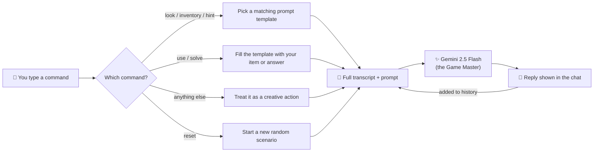

<div align="center">

# 👁️ THE AI ESCAPE

### *The door is sealed. The torches are dying. The Game Master is watching.*


**[🔥 Enter the Chamber (Live Demo)](https://huggingface.co/spaces/imaniketrajput/ai-escape-room)**

</div>

---

## 📜 The Legend

You wake up in a room you do not remember entering.
The air is cold. Something on the wall is *glowing*.
Behind you, a lock clicks shut.

An AI **Game Master** has built a room just for you: a haunted mansion, an abandoned lab, a forgotten library, an ancient tomb. No two nights are the same. Every puzzle can be solved in **3 to 5 steps**, but only if you look closely, think carefully, and trust nothing.

> *"Every room has a way out. Few have the patience to find it."*

**The AI Escape** is a text-based escape room where Google Gemini plays the Game Master. It invents a fresh scenario each time, remembers what you carry, tracks which puzzles you have solved, and reacts to whatever you decide to do.

---

## 🗝️ Ancient Commands

| Command | What it does |
|---|---|
| `look` | Scan the room again. New objects and changes appear here. |
| `inventory` | Check what you are carrying. |
| `use [item]` | Try an item on the room, a lock, or a clue. |
| `hint` | A whispered clue about the current puzzle. Never the answer. |
| `solve [answer]` | Speak your solution to the puzzle in front of you. |
| `reset` | Burn it all down and start a brand new scenario. |

💀 **Or type anything.** *"Break the glass"*, *"read the diary"*, *"shake the clock"*. The Game Master decides whether it works.

---

## 🕯️ How It Works

There is no game engine and no hard-coded puzzles. **The AI is the engine.** Here is what happens every time you press Enter:



### The five moving parts

1. **The Game Master persona.** A system prompt tells Gemini it is an escape room Game Master. It must stay inside the escape room, keep track of progress, inventory and puzzle state, and keep every puzzle solvable.
2. **Command prompts.** Each command (`look`, `inventory`, `use`, `hint`, `solve`, `reset`) has its own prompt template in `app.py`. Your input is matched to a template and filled in. For example, `use brass key` becomes a prompt asking whether a brass key exists in your inventory and what it does.
3. **Memory through the transcript.** The app does not store the game in a database. The **chat history is the game state.** On every turn, the whole conversation is rebuilt as a transcript and sent to Gemini, so the Game Master "remembers" the room, your items and your progress.
4. **Creative actions.** If your input is not a known command, the Game Master treats it as an improvised action. It decides if it is plausible, then describes the result or steers you back to a valid command.
5. **The interface.** [Gradio](https://www.gradio.app/) renders the chat window, with a custom dark Egyptian theme, glowing gold accents, and a ☀️/🌙 theme toggle.

> ⚠️ Because the AI generates every puzzle live, the game is different every time, and the Game Master can occasionally be wrong or forgetful. Use `reset` if the story breaks.

---

## ⚡ Quick Start

### Get your key

Get a free Gemini API key at [aistudio.google.com/apikey](https://aistudio.google.com/apikey).

### 🐍 Option 1: Run with Python

```bash
git clone https://github.com/imaniketrajput/ai-escape-room.git
cd ai-escape-room

pip install -r requirements.txt

# macOS / Linux / Git Bash
export GEMINI_API_KEY="your_key_here"
# Windows PowerShell:  $env:GEMINI_API_KEY="your_key_here"

python app.py
```

Open the local URL printed in the terminal (usually `http://127.0.0.1:7860`).

### 🐳 Option 2: Run with Docker

Make sure Docker Desktop (or Docker Engine) is **running**, then:

```bash
git clone https://github.com/imaniketrajput/ai-escape-room.git
cd ai-escape-room

# Create your secret file (never commit this)
echo "GEMINI_API_KEY=your_key_here" > .env

# Build the image
docker build -t ai-escape-room .

# Release the Game Master
docker run -d -p 7860:7860 --env-file .env --name escape-room ai-escape-room
```

Then open **http://localhost:7860** and step inside.

```bash
docker logs escape-room     # peek behind the curtain
docker stop escape-room     # leave the chamber
docker rm escape-room       # erase all traces
```

> 🔒 The API key is **never** baked into the image. It is passed in at run time with `--env-file` or `-e`.

### 🐳 Option 3: Pull a prebuilt image (if published)

```bash
docker run -d -p 7860:7860 -e GEMINI_API_KEY=your_key_here \
  --name escape-room YOUR_DOCKERHUB_USERNAME/ai-escape-room:1.0
```

---

## 🏺 Project Structure

```
ai-escape-room/
├── app.py             # Game logic, prompts, Gemini calls, Gradio UI and theme
├── requirements.txt   # gradio, google-generativeai
├── Dockerfile         # Container recipe (python:3.11-slim)
├── .dockerignore      # Keeps secrets and junk out of the image
└── README.md          # You are here
```

---

## 🧰 Built With

| Layer | Tech |
|---|---|
| Game Master | Google Gemini 2.5 Flash (`google-generativeai`) |
| Interface | Gradio, custom CSS (dark and light themes) |
| Packaging | Docker (`python:3.11-slim`) |
| Hosting | Hugging Face Spaces |

---

## 🔐 Security Notes

- Keep your key in an environment variable or `.env`. **Never hard-code it** in `app.py`.
- `.env` is listed in `.dockerignore` and should also be in `.gitignore`.
- If a key ever appears in a screenshot, a commit or a chat, delete it and create a new one.

---

## 🧭 Roadmap

- [ ] Difficulty levels (easy, medium, nightmare)
- [ ] A turn counter and a timer for the escape
- [ ] Save and resume games
- [ ] Migrate to the newer `google-genai` SDK
- [ ] Sound effects and ambient music

---

## ☠️ A Final Warning

The chamber is waiting. The Game Master has already begun to write your story.
The only question is whether you will write the ending.

<div align="center">

**© 2026 Aniket Singh · AI Escape Room Generator**

*Made with Gemini, Gradio, and a little darkness.*

</div>
